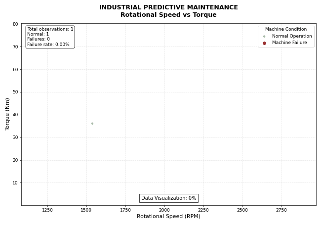

# Industrial Predictive Maintenance | Python Data Analysis

## Project Overview

Can industrial data help engineers better understand machine failures?

This project explores the relationship between rotational speed, torque, and machine failures using Python.

The objective is to analyze industrial operating conditions, visualize failure patterns, and demonstrate how data analytics can support equipment reliability and maintenance engineering.

An animated GIF illustrates the distribution of normal operating conditions and recorded machine failures.

## Visualisation
https://github.com/tekyamba5-lgtm/Industrial-Predictive-Maintenance/blob/main/predictive_maintenance_animation.gif

## Dataset

Dataset: AI4I 2020 Predictive Maintenance Dataset

Source: UCI Machine Learning Repository

https://archive.ics.uci.edu/dataset/601/ai4i

The dataset contains 10,000 synthetic industrial observations.

### Parameters Analyzed

- Rotational Speed (RPM)
- Torque (Nm)
- Machine Failure (0 = Normal, 1 = Failure)

## Key Results

| Machine Condition | Observations | Percentage |
|-------------------|-------------:|-----------:|
| Normal Operation | 9,661 | 96.61% |
| Machine Failure | 339 | 3.39% |
| Total | 10,000 | 100% |

The dataset contains 339 recorded machine failure observations.

## Data Visualization

The scatter plot illustrates the relationship between rotational speed and torque.

- X-axis: Rotational Speed (RPM)
- Y-axis: Torque (Nm)
- Green points: Normal Operation
- Red points: Machine Failure

The visualization helps identify operating regions associated with recorded failures.

### Animated Visualization

The GIF progressively displays industrial observations and updates the failure statistics.

Note: The animation illustrates the dataset distribution, not the chronological evolution of equipment failures.

## Technologies Used

- Python
- Pandas
- NumPy
- Matplotlib
- Pillow (PIL)

## Methodology

1. Import the industrial dataset using Pandas.
2. Select rotational speed, torque, and machine failure variables.
3. Clean and validate the data.
4. Separate normal operating conditions from machine failures.
5. Calculate the overall failure rate.
6. Generate a scatter plot using Matplotlib.
7. Create an animated GIF using Pillow.
8. Export the visualization as PNG and GIF files.

## Project Outputs

The Python program generates:

1. predictive_maintenance_visualization.png
2. predictive_maintenance_animation.gif

## Industrial Applications

Industrial data analysis can support:

- Equipment condition monitoring
- Machine failure pattern identification
- Reliability engineering
- Maintenance planning
- Data-driven maintenance strategies
- Future predictive maintenance applications

These applications are particularly relevant to mining equipment and industrial machinery.

## Project Limitations

This project focuses on exploratory data analysis and visualization.

It does not currently implement a machine learning prediction model.

The AI4I 2020 dataset is synthetic, and the results should not be interpreted as validated predictions of real industrial equipment failures.

Future developments may include machine learning classification models and additional equipment monitoring parameters.

## Conclusion

Understanding the relationship between mechanical operating parameters and equipment failures is an important foundation for data-driven industrial maintenance.

This project demonstrates how Python-based data analysis and visualization can help engineers explore equipment behavior and support future predictive maintenance research.

## Author

Ekyamba Trésor Ababel

Electromechanical Engineer | Maintenance & Reliability | Data Science & Machine Learning

## Keywords

Predictive Maintenance, Reliability Engineering, Industrial Data Analytics, Rotational Speed, Torque, Machine Failure, Python, Mining Technology.
